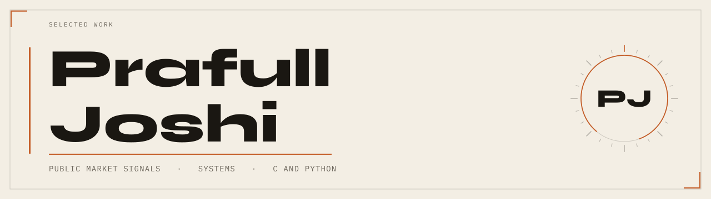

  <picture>
    <source media="(prefers-color-scheme: dark)" srcset="assets/banner-dark.svg">
    <source media="(prefers-color-scheme: light)" srcset="assets/banner-light.svg">
    
  </picture>

I build instruments that read public market positioning, tools that show what a system actually isolates, and small programs that make a concept easy to inspect. I care about clean modular code, tests, and documentation a reader can follow without asking me.

  
  
  
  

## Selected work

**[Metal Future Forecast](https://github.com/PrafullJ0shi/metal-future-forecast)** · [live site](https://prafullj0shi.github.io/metal-future-forecast/)  
Reads where Hyperliquid's top 500 wallets sit in gold and silver perpetuals and turns that into a long or short call per metal, refreshed every 30 minutes, with a backtest from 1 hour to 1 week.

**[hyperliquid-btc-signal](https://github.com/PrafullJ0shi/hyperliquid-btc-signal)** · [live site](https://prafullj0shi.github.io/hyperliquid-btc-signal/)  
The same idea pointed at Bitcoin: positioning among last-month Hyperliquid leaders, with flows and a 30-day backtest.

**[computing-systems-arena](https://github.com/PrafullJ0shi/computing-systems-arena)** · [play in the browser](https://prafullj0shi.github.io/computing-systems-arena/)  
A study game for Computing Systems with 13 weekly worlds, architecture simulators, mock exams and flashcards.

**[student-record-system](https://github.com/PrafullJ0shi/student-record-system)**  
A C11 terminal register: linked-list store, checksummed file format, CSV import and export, and cohort statistics drawn as terminal charts. 207 unit tests, sanitizer- and Valgrind-clean CI.

**[RupeeClarity](https://github.com/PrafullJ0shi/RupeeClarity)** · [run in the browser](https://prafullj0shi.github.io/RupeeClarity/)  
A menu-driven C program that calculates, compares and explains simple and compound interest in rupees, with year-by-year tables and the Rule of 72.

**[CareerConnect](https://github.com/PrafullJ0shi/CareerConnect)** · [static demo](https://prafullj0shi.github.io/CareerConnect/)  
A job portal in Flask and SQLite for listings, search, applications and accounts.

**[computing-systems-investigator](https://github.com/PrafullJ0shi/computing-systems-investigator)**  
Collectors and a write-up on profiling a Windows laptop and measuring what an isolated Python virtual environment actually isolates.

## What I work with

- **Languages:** C, Python, TypeScript
- **Systems:** pointers and memory, file handling, linked lists, stacks, queues and trees
- **Data:** statistics, NumPy, pandas and visualisation
- **Tooling:** Git, GitHub Actions, Linux, Make, CMake, Valgrind

## Now

The gold, silver and bitcoin signal sites are live and refresh on their own. I am tightening those instruments and going deeper into data structures in C.

## Contact

Open an issue on any project, or reach me through [GitHub](https://github.com/PrafullJ0shi).
